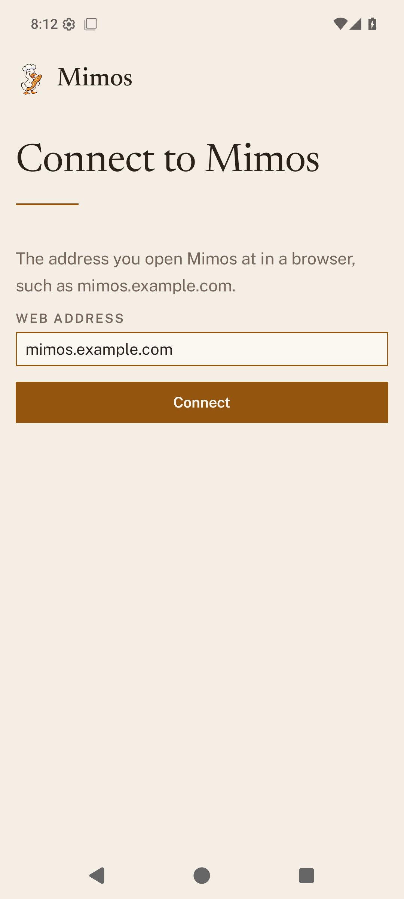
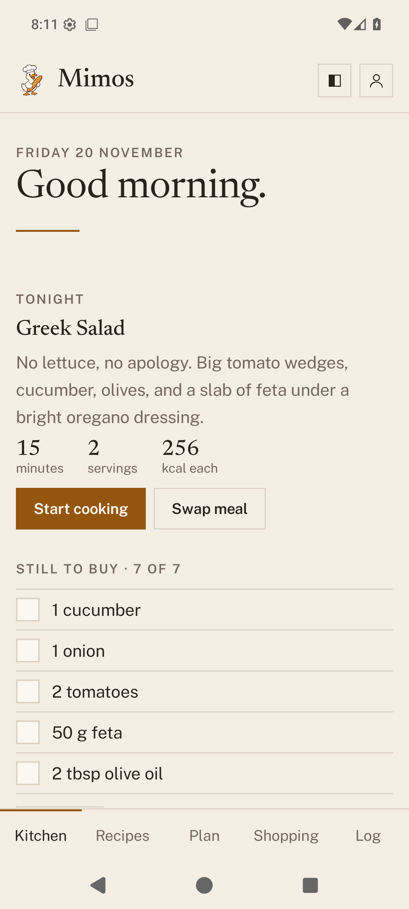

# The Android app

Mimos has an app for Android phones (Android 8.0 or later). It talks to the
same Mimos server as the web, so you sign in with the same account and see
the same recipes and plans. It is not in any app store, and it needs no
Google services.

## Install it

1. On your phone, open the
   [latest release](https://github.com/noahhhx/mimos/releases/latest) and
   download `mimos-<version>.apk`.
2. Open the downloaded file. Android asks you to allow installs from your
   browser the first time; allow it, then choose **Install**.
3. Open Mimos, type the address you open Mimos at in a browser, and choose
   **Connect**. Then sign in.

{ width="300" }

To check the download, compare it with the `.sha256` file beside it in the
release: `sha256sum -c mimos-<version>.apk.sha256` on a computer.

## Find your way around

The app does what the web does. It opens on your Kitchen: tonight's
dinner, what is still to buy, and the week ahead. The tabs at the bottom
are **Kitchen**, **Recipes**, **Plan**, **Shopping**, and **Log**. The
person button at the top opens **Household**, **Plugins**, **Fuel**,
**Your data**, **Settings**, and **Sign out**. The rest of this guide
describes each of them as the web shows it.

{ width="300" }

**Settings** is the one place the web has no match for. It holds the
light and dark choice, the server you are connected to and the version
it runs, **Change instance** to connect somewhere else, and the app's
version and licences.

The app needs a connection to your server, except to tick off the
shopping list.

## Shop with no signal

The app keeps the shopping lists you open on the phone, the last four
weeks of them. In a shop with no signal you can still tick items off: the
list says **Offline** and how many ticks are waiting to send, and each
waiting item says **Not sent**. The ticks stay on the phone even if it
closes the app, and they are sent once the phone has a network again. If
they still have not gone through, choose **Send now**.

If Mimos cannot reach your server when you open the app, it says **No
answer**. Choose **Shopping list** there to tick the list as it was last
loaded. The ticks are sent once you are signed in again.

Only ticking works offline. Adding or removing an item, and generating the
list, need a connection. If someone else in your household regenerates the
list before your ticks arrive, those ticks are dropped. Signing out
forgets the stored lists and any ticks not yet sent.

## Keep it up to date

The app and the server share one version number and are released
together. When your server runs a newer Mimos than the app, the app says
**A newer app is available** under its header. Choose **Get the new app**
to open the release, and install it over the one you have. You stay
signed in. **Not now** hides the notice until Mimos is closed and started again.

If your server has changed in a way an older app cannot follow, the app
shows **Update the app** and nothing else until you do.

To update without checking by hand, use an updater that follows GitHub
releases, such as [Obtainium](https://obtainium.imranr.dev/). Add the app
in Obtainium with the address `https://github.com/noahhhx/mimos`, and it
tells you when a new release is out and installs it. Release candidates
are marked as prereleases on GitHub; Obtainium skips them unless you turn
on **Include prereleases**.
