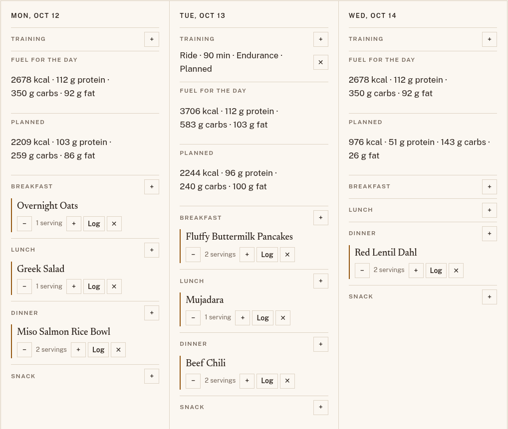
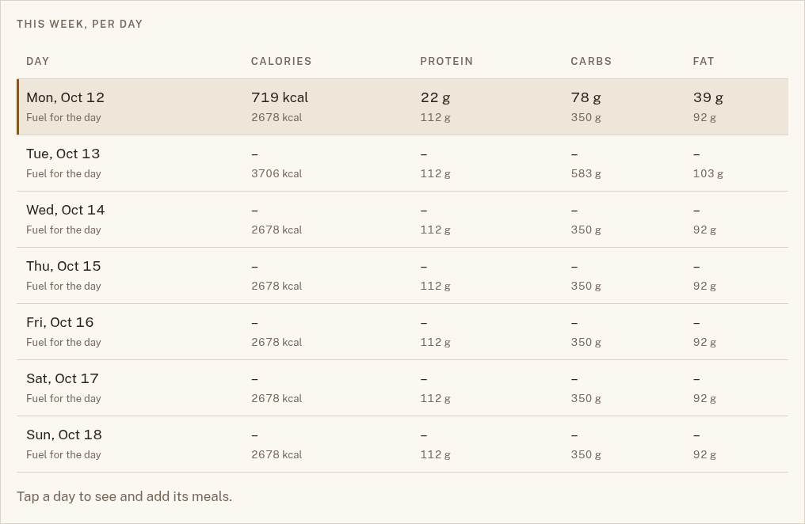

# Fuel targets

Fuel targets give you a calorie, carb, protein, and fat figure for each day,
shown beside what you planned and what you logged. The figure rises on the
days you train, so a long ride gets the food it needs and a rest day stays
lighter. Mimos calls it **Fuel for the day**: it is information, not a
score. Nothing turns red or green, and nothing counts streaks.

Targets are off until you turn them on. While they are off, no page shows
them.

## Turn targets on

1. Open the profile menu at the top right and choose **Fuel**.
2. Select **Show fuel targets**.
3. Under **About you**, enter your **Weight (kg)** and choose your sex, or
   **Prefer not to say**. **Body fat (%)** and **FTP (watts)** are
   optional; see [Where the numbers come from](#where-the-numbers-come-from)
   for what each one changes.
4. Under **Your goal**, choose one of the four goals. **Protein (g per kg)**
   fills in for the goal you choose. Change it if you like, from 1.2 to
   3.0 g per kg.
5. Choose **Save**.

To turn targets off again, clear **Show fuel targets** and choose **Save**.
Mimos keeps the rest of your settings for next time.

Your fuel settings and training are yours alone. In a
[household](household.md), everyone has their own, and
[plugins](plugins.md) never see them.

## The four goals

| Goal                      | Energy for the rest of the day | Protein to start with |
| ------------------------- | ------------------------------ | --------------------- |
| **Fuel my training**      | 45 kcal per kg of fat-free mass | 1.6 g per kg         |
| **Lose weight gradually** | 40 kcal per kg of fat-free mass | 2.0 g per kg         |
| **Lose weight faster**    | 35 kcal per kg of fat-free mass | 2.2 g per kg         |
| **Gain weight**           | 50 kcal per kg of fat-free mass | 1.8 g per kg         |

Every goal adds the full energy of your training on top, so even the weight
loss goals fuel the work you do. Any deficit comes from the rest of the day,
never from your training. No goal goes below 35 kcal per kg of fat-free
mass, which keeps a margin above the level at which low energy starts to
harm health and performance.

## Where you see your targets

### On the plan

With targets on, each day on the [plan](planning.md) shows three lines
above its meals:

- **Training**: the sessions you've added for that day.
- **Fuel for the day**: the day's target.
- **Planned**: what you'll eat if you eat what you planned. See
  [Your planned total](planning.md#your-planned-total).



In a shared household, these lines show in **Mine** only, because they are
yours alone. **Everyone** shows none of them.

### In the log

In the [food log](log.md), the week's table shows each day's **Fuel for the
day** under what you logged that day. A day with nothing logged keeps its
dash.



## Add your training

Mimos counts the training you add to a day.

1. Open **Plan** and find the day.
2. Choose **+** next to **Training**.
3. Choose the **Sport**: Ride, Run, Swim, Strength, or Other.
4. Enter the **Minutes**, from 1 to 1440.
5. Choose the **Intensity**:
    - **Easy**: a recovery spin or a gentle jog; you could chat all the way.
    - **Endurance**: a steady session you could keep up for hours.
    - **Hard**: intervals, a race, or anything near your limit.
6. Choose **Add**.

The day's fuel for the day changes at once. A day can hold several
sessions, and they add up. To take one out, choose **✕** next to it.

## Where the numbers come from

Every target is worked out from your settings and that day's training each
time you look, so a change to your weight, your goal, or your training
reaches every day straight away.

### Calories

```
calories = goal level × fat-free mass + training energy
```

**Fat-free mass** is your weight minus your body fat. If you leave
**Body fat (%)** empty, Mimos assumes 15% for men, 25% for women, and 20%
if you'd rather not say.

**Training energy** is worked out for each session:

- **A ride, with your FTP set.** Your FTP times a share of it for the
  intensity (55% for easy, 68% for endurance, 85% for hard), times the
  minutes, gives the work you do in kilojoules. Mimos counts that as the
  same number of kilocalories: the body turns about a quarter of the energy
  it burns into work on the pedals, and that quarter almost exactly cancels
  the 4.184 kilojoules in a kilocalorie.
- **Anything else**, or a ride without an FTP: an estimate from your weight,
  the minutes, and the intensity, using typical values from the Compendium
  of Physical Activities.

For example, a 70 kg rider with 15% body fat who chooses **Fuel my
training** has 59.5 kg of fat-free mass, so a rest day comes to 45 × 59.5,
or about 2678 kcal. With an FTP of 280 watts, a 90-minute endurance ride
is about 1028 kJ of work, so that day comes to about 3706 kcal.

### Carbs

Carbs follow published ranges for how much you train that day, counting
every session's minutes together:

| Training that day     | Carbs           |
| --------------------- | --------------- |
| None                  | 3–5 g per kg    |
| Less than 75 minutes  | 5–7 g per kg    |
| 75 minutes to 4 hours | 6–10 g per kg   |
| 4 hours or more       | 8–12 g per kg   |

### Protein

Protein is your **Protein (g per kg)** setting times your weight.

### Fat, and how the three fit

Mimos fills the day's calories in this order:

1. Protein comes first.
2. Carbs take what's left once fat has 25% of the calories, kept within the
   day's carb range.
3. Fat takes the rest.

The calories never change. If that leaves fat below 20% or above 35% of
the day's calories, carbs move outside their range by the smallest amount
that brings fat back between 20% and 35%. This happens most with
**Gain weight**, or with a high protein setting.

The 70 kg rider's rest day has 112 g of protein and 350 g of carbs, the top
of its 3–5 g per kg range, which leaves 92 g of fat, 31% of the calories.
The ride day has 583 g of carbs, inside its 6–10 g per kg range, and 103 g
of fat, 25% of the calories.

## Sources

- **Energy availability**, the idea behind the goal levels: Loucks, Kiens,
  and Wright, "Energy availability in athletes", *Journal of Sports
  Sciences* 29, supplement 1 (2011); and the International Olympic
  Committee's 2023 consensus statement on Relative Energy Deficiency in
  Sport (REDs), *British Journal of Sports Medicine* 57 (2023).
- **The levels 45, 40, and 35** match TrainerRoad's nutrition calculator.
  The level 50 for **Gain weight** is Mimos's own estimate and has no
  published source yet.
- **Carb ranges**: Burke, Hawley, Wong, and Jeukendrup, "Carbohydrates for
  training and competition", *Journal of Sports Sciences* 29, supplement 1
  (2011); and Thomas, Erdman, and Burke, "Nutrition and Athletic
  Performance", the joint position of the American College of Sports
  Medicine, the Academy of Nutrition and Dietetics, and Dietitians of
  Canada, *Medicine & Science in Sports & Exercise* 48 (2016).
- **Training energy without power**: the Compendium of Physical
  Activities.

Fuel targets are a starting point drawn from sports nutrition guidance,
not medical advice. If you have a health condition, or a history of
disordered eating, talk to a doctor or a sports dietitian before you use
them.
