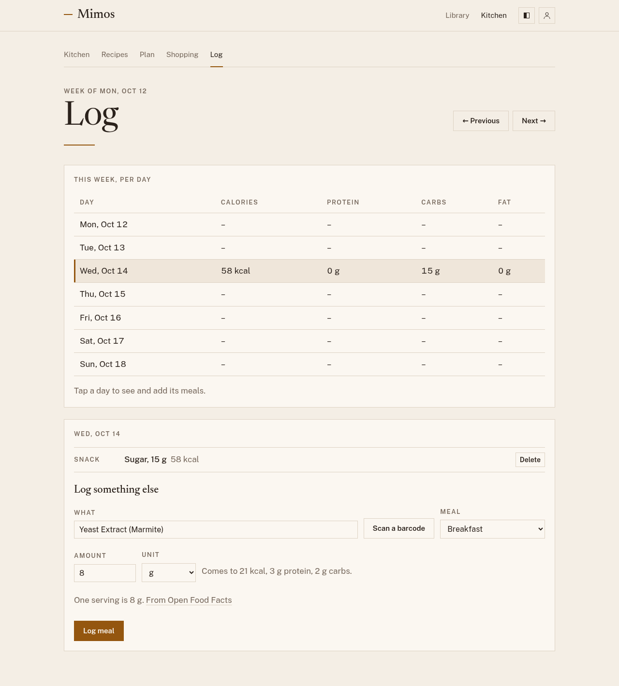

# Food log

Open **Log** to see what you've eaten, with calories, protein, carbs, and
fat added up for each day of the week. The numbers are information for you,
nothing more: there are no streaks to keep, and no goals unless you turn on
[fuel targets](fuel.md). Even then, each day's target sits beside what you
logged with no score.

## Logging a planned meal

In the [plan](planning.md), choose **Log** on a meal once you've eaten it.
Mimos works out its nutrition from the recipe and the servings you planned.
A recipe without nutrition still logs; it just adds nothing to the totals.

In a [household](household.md), you log only your own share of a meal
you shared. When a meal has more than one person eating it, **Log** asks
for **Your share** first. It starts at the servings divided by the number
of people eating, to the nearest 0.1 serving: 3 servings for 2 people is
1.5 servings each. Change it if you ate more or less, then choose **Log
share**. **Log** appears only on meals you eat.

## Logging something else

For anything you didn't plan, log a recipe, log an ingredient, or
describe what you ate.

To log a recipe:

1. In **Log**, choose the day in the week's table.
2. Under **Log something else**, start typing the recipe's name in
   **What**. The list shows your household's recipes and the library's,
   each with its calories per serving.
3. Choose the recipe, and choose which meal it was.
4. In **Servings**, enter how much you ate, from 0.1 to 100. Mimos shows
   what that comes to.
5. Choose **Log meal**.

Mimos works out the nutrition from the recipe, as it does for a planned
meal. If you type over the recipe's name, the entry stops being that
recipe.

To log a single ingredient, such as sugar in your coffee or a banana:

1. In **Log**, choose the day in the week's table.
2. Under **Log something else**, start typing the ingredient's name in
   **What**. The list shows the shared ingredients and your household's
   own, each with its calories per 100 g, per 100 ml, or each.
3. Choose the ingredient, and choose which meal it was.
4. Enter the **Amount** and choose its **Unit**. Mimos offers only the
   units that fit the ingredient: weights (g, kg), volumes (ml, l, tsp,
   tbsp), or pieces. It starts at 100 g, 100 ml, or 1 piece, and shows
   what the amount comes to.
5. Choose **Log meal**.

The entry is named with the amount, like "Sugar, 15 g", and keeps the
nutrition Mimos showed you, so a later fix to the ingredient doesn't
change what you logged.

To log something that isn't a recipe or an ingredient:

1. In **Log**, choose the day in the week's table.
2. Under **Log something else**, type what it was in **What** without
   choosing from the list, and choose which meal.
3. Fill in whatever you know of the calories, protein, carbs, and fat.
   Every number is optional.
4. Choose **Log meal**.

## Fixing a mistake

Choose a day in the table to see everything logged for it, and **Delete**
anything that shouldn't be there. A dash in the table means nothing is
logged for that day, not zero.
