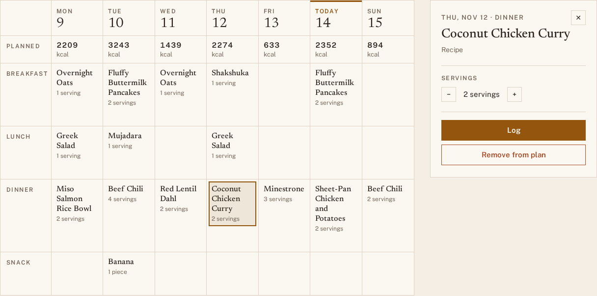
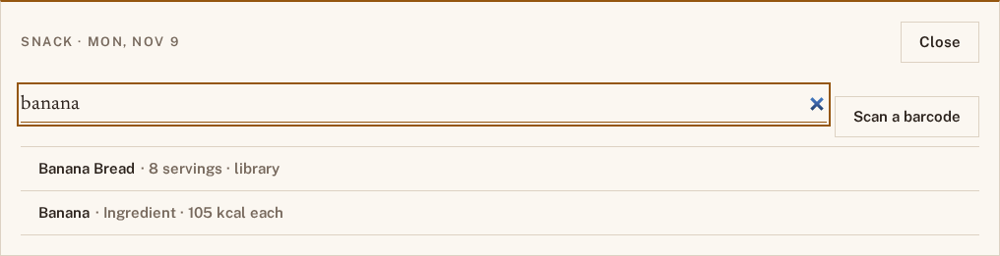
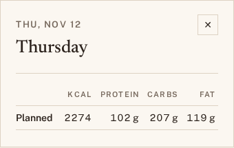
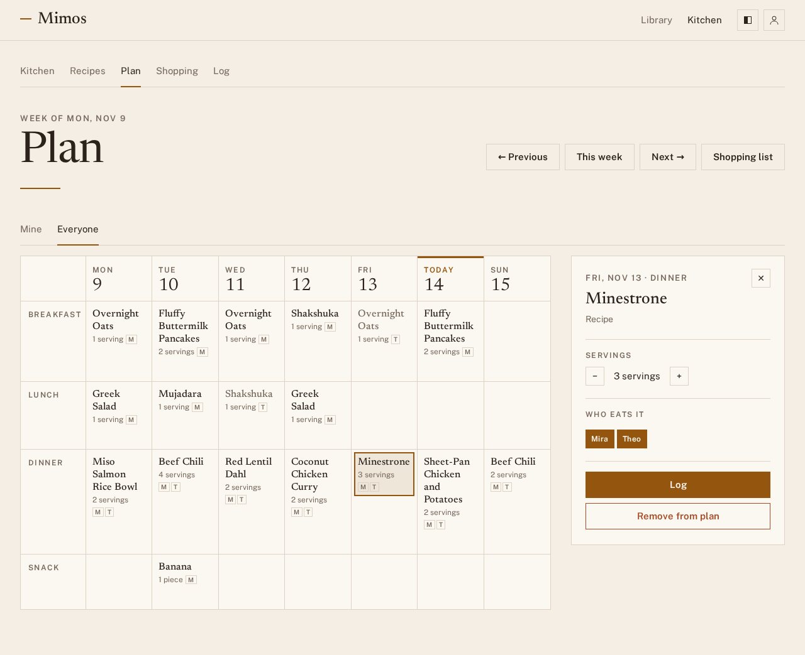
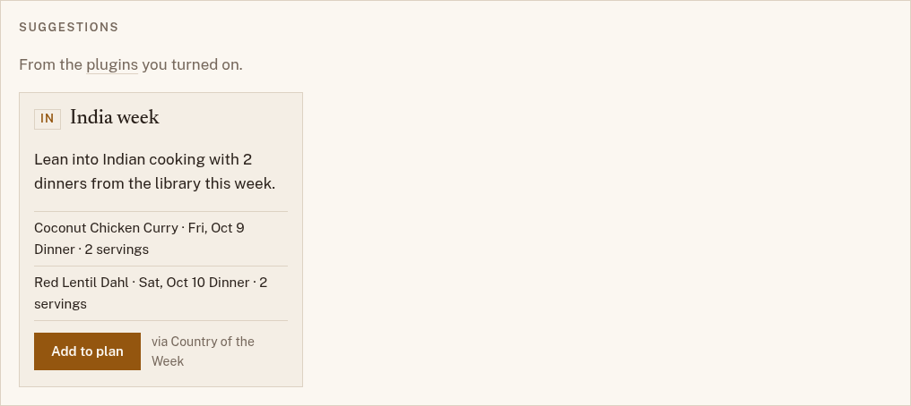
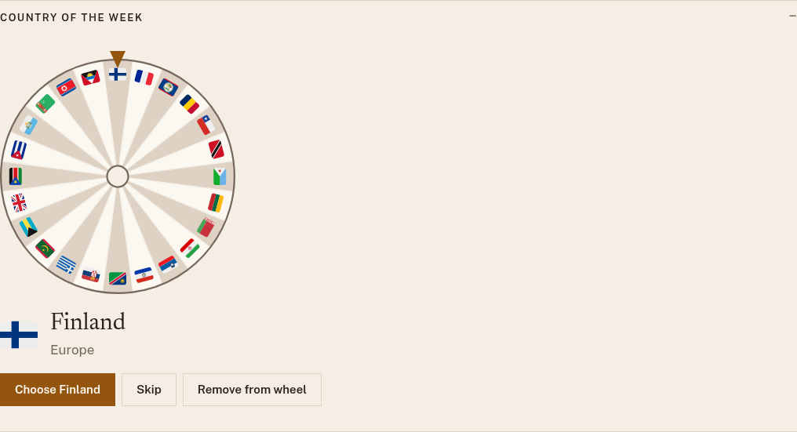

# Planning a week

Open **Plan** to see a week of meals as a table: the days run across,
Monday to Sunday, and the four slots run down: breakfast, lunch, dinner,
and snack. Each slot shows what's planned in it and how much. Today's
column is marked at the top. Use **← Previous** and **Next →** to move
between weeks, and **This week** to come back.

Select a meal to see its details beside the table, where you change it
(see [Changing a planned meal](#changing-a-planned-meal)). Select it
again, choose **✕**, or press Escape to close them. On a phone, the table
scrolls sideways with the slot names kept in view, and the details open at
the bottom of the screen.

## Adding a meal

1. Point at the slot you want to fill and choose **+**. On a phone, the
   **+** always shows.
2. Search your recipes, the library, and ingredients, or scroll the list.
3. Choose a recipe. It goes into the slot for 2 servings, or, when you
   [share a household](#planning-for-a-household), one serving for each
   person eating it. Choosing an ingredient plans
   [a single food](#planning-a-single-food) instead.

A slot can hold more than one recipe, such as a main and a side.

## Planning a single food

Not everything needs a recipe. A snack slot can hold one ingredient, such
as a banana, straight from the search in [Adding a meal](#adding-a-meal).

1. Choose **+** in the slot you want to fill.
2. Start typing the ingredient's name, such as "banana". Ingredients
   follow the recipes in the list: the shared ones and your household's
   own, each marked as such with its calories.
3. Choose the ingredient. It goes into the slot for each person eating
   it, at 1 piece, or 100 g or 100 ml when it's measured that way.

A planned food shows its name and amount, such as "Banana, 1 piece" or
"Bagel, 85 g". Select it, and its details have an **Amount** you can type
over, with its unit beside it, instead of the servings buttons. Press
Enter, or leave the field, to save the new amount. An amount Mimos can't
use goes back to what was planned.

**Scan a barcode** in the picker looks a packaged product up in
[Open Food Facts](https://world.openfoodfacts.org), as on the
[log page](log.md#logging-something-else): point the camera at it, or
type the number. If the product has all four nutrition values, Mimos
saves it as one of your household's ingredients and plans it at its
serving size, or at 100 g or 100 ml when it has none. Scanning the same
product again plans that ingredient rather than adding a second copy, so
you can also find it by name in the search next week. If Open Food Facts
lacks a value, Mimos opens the new-ingredient form with what it did
find, so you can fill in the rest and save. Choose **Cancel** to go back
to the picker; nothing is saved.

A planned food works like any other meal: **Log** logs your share of its
amount, the [planned total](#your-planned-total) and
[Fuel for the day](fuel.md) count it, and the [shopping
list](shopping-list.md) lists it by name and amount.

## Changing a planned meal

Select a meal in the table. Its details show its name, which links to the
recipe, and these:

| Control     | What it does                                                    |
| ----------- | --------------------------------------------------------------- |
| **Servings** **−** / **+** | Fewer or more servings of a recipe, half a serving at a time. A planned food has an **Amount** field instead. |
| **Who eats it** | Who in the household eats the meal. Only when you [share a household](#planning-for-a-household). |
| **Log**     | Adds the meal to your [food log](log.md) for that day. Only on meals you eat. |
| **Remove from plan** | Takes the meal out of the plan.                        |

Servings matter: the [shopping list](shopping-list.md) and the food log
both scale each recipe to the servings you planned.

To swap a meal, take it out with **Remove from plan** and add another.
The Kitchen's **Swap meal** button brings you here for that.

## Your planned total

The **Planned** row, above the meals, shows the calories you will eat each
day if you eat what you planned. A day with nothing planned shows a dash.
Select a day, by its name at the top of the table or its **Planned**
figure, to see its protein, carbs, and fat too.

- A meal you eat alone counts every serving planned.
- A meal you [share](#planning-for-a-household) counts your share: its
  servings divided by the number of people eating it. **Log** fills in
  the same share, so a planned day and its logged day agree.
- If a recipe has no value for calories, protein, carbs, or fat, that
  value adds nothing to the total. The recipe's other values still
  count, as they do when you log it. The day says how many of its meals
  have unknown nutrition. A value that no meal that day has is left out
  rather than shown as 0, so a day where no meal has any known calories
  shows a dash in the table, and its details show dashes for every value
  it lacks. Add the recipe's nutrition to count it.

In a shared household, the total shows in **Mine** only, because it is
yours alone. **Everyone** shows no totals.

With [fuel targets](fuel.md) on, the table also has a **Training** row,
the **Planned** row reads each day's calories against its **Fuel for the
day**, such as "2244 of 3706 kcal", and a day's details show its training
and both rows of nutrition.

## Planning for a household

When you [share a household](household.md), everyone in it plans the same
week. Each meal says who eats it, so a dinner can be for everyone and a
lunch for one person.

**Who eats it.** In the table, each meal shows the initials of the people
eating it. Select the meal, and its details have a button for each person
in the household under **Who eats it**. A filled button means that person
eats the meal. Choose a button to add or remove that person. A meal always
has someone eating it, so the last filled button can't be removed.

A new meal starts with:

| Meal                      | Who eats it      | Servings             |
| ------------------------- | ---------------- | -------------------- |
| Dinner                    | Everyone         | One for each person  |
| Breakfast, lunch, snack   | You              | One                  |

Servings are what gets cooked, for everyone eating it together, so the
[shopping list](shopping-list.md) buys for the whole household. Changing
who eats a meal doesn't change its servings; use **−** and **+** for that.

**Mine and Everyone.** Above the week, **Mine** shows only the meals you
eat, shared dinners included. **Everyone** shows the whole household's
meals, so you can see what others have planned; meals you don't eat are
greyed. Mimos remembers your choice on each device.

A household of one sees none of this: no initials, no **Who eats it**,
and no toggle.

## Suggestions

If you've turned on a [plugin](plugins.md) that suggests meals, its ideas
appear under **Suggestions**, beside the week (below it on a phone). Each card says which
plugin it came from and which meals it would add.

{ width="420" }

Choose **Add to plan** to add those meals to the slots listed on the card,
or ignore the card. Nothing is added until you choose. The Kitchen may also
offer one suggested dinner for an open evening this week.

## Country of the Week

With the [Country of the Week](plugins.md#country-of-the-week) plugin
turned on, a **Country of the Week** line sits beside the week, under a
meal's details (below the week on a phone). It stays
closed until you open it, so weeks you don't want a country for look the
same as before.

{ width="640" }

1. Open the **Country of the Week** line and choose **Spin**.
2. When the wheel stops, choose one:
    - **Choose** locks the country to this week. Nothing is added to your
      plan.
    - **Skip** spins again. The country stays on the wheel for later.
    - **Remove from wheel** takes the country off the wheel for good,
      then spins again.

A week with a country shows its flag and name on the closed line. To pick
again, open it and choose **Change country**; the country goes back on the
wheel. Suggested dinners from the country's cuisine appear under
[Suggestions](#suggestions) when the library has any, and you add them
only if you want them.

## Your plan on every device

Plans are saved as you go, so the week you plan on your laptop is the week
your phone shows in the store.
