# Recipes

Open **Recipes** to see your recipe book. It has two tabs, plus any
[tabs you add](#tabs):

- **My recipes**: the recipes you and your [household](household.md) have
  written. Only your household can see them, and a recipe someone else
  added says **Added by** them when you open it.
- **Library**: free recipes curated for everyone on this Mimos. Anyone can
  read them, signed in or not.

The search box looks through titles, descriptions, tags, and ingredient
names in the tab you're on, so "beef" also finds a chili made with beef
mince.

Use **Sort by** to order the recipes by title, by when they were added,
or by when they were last edited. The default is alphabetical by title.

The tag buttons under the search show every tag used in the tab you're
on. Press one to show only recipes with that tag. Press another to narrow
it further; a recipe must have every chosen tag. Press a chosen tag again
or choose **Clear tags** to widen the list back out. The tab counts stay
as totals; only the list below them is filtered.

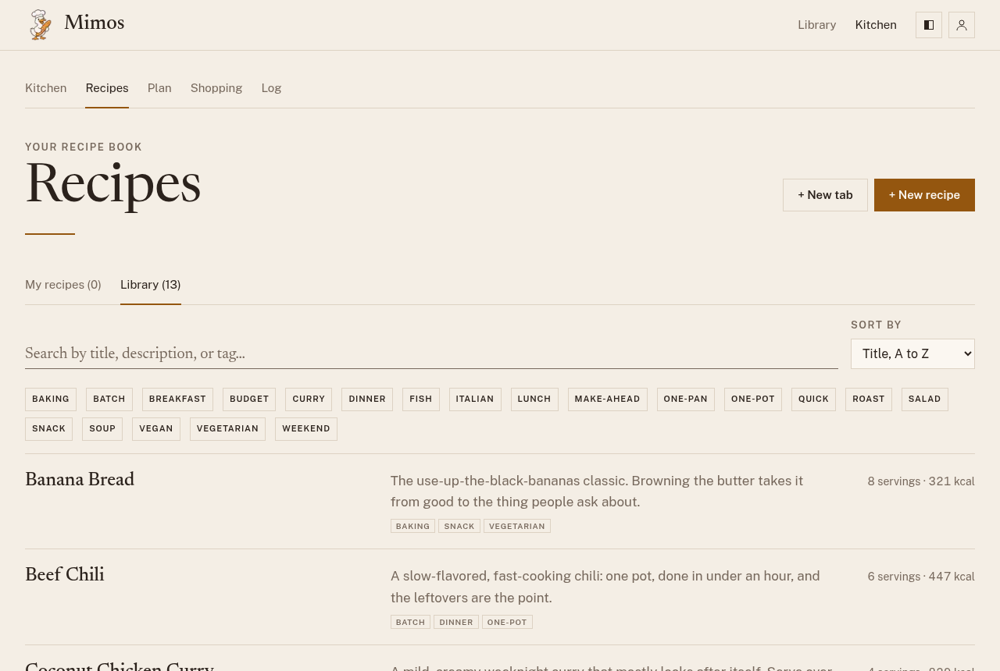

## Tabs

Add your own tabs to sort recipes the way you cook, like "Weekend brunch"
or "Soups and stews". A tab holds:

- recipes you pick for it, from your recipes and the library, and
- every recipe with any of the tab's tags, including recipes you write or
  tag later.

A recipe can be in more than one tab. Tabs belong to your
[household](household.md): everyone in it sees and edits the same tabs.

### Making a tab

1. In **Recipes**, choose **+ New tab**.
2. Give it a name. Two tabs in a household can't share a name.
3. Optional: under **Picture**, choose **Choose picture** to give the tab
   a cover for the gallery. Mimos shrinks it before it sends it, the same
   way it shrinks [recipe pictures](#pictures).
4. Under **Tags**, press the tags the tab gathers by. Every tag in your
   recipes and the library is listed. To use a tag no recipe has yet, type
   it in **New tag** and choose **Add tag**.
5. Under **Recipes**, tick the recipes to keep in the tab whatever their
   tags. Use the search box to find one.
6. Optional: tick **Open Recipes on this tab**.
7. Choose **Create tab**.

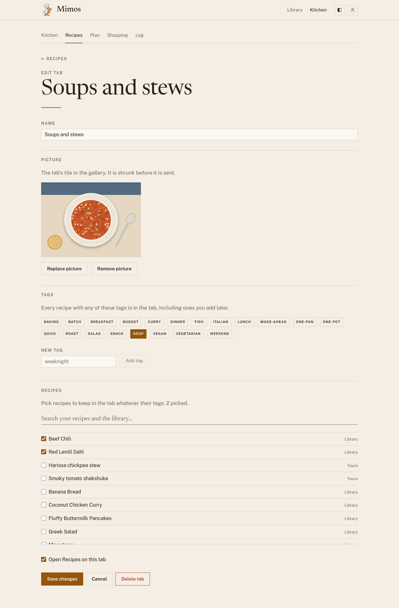

A tab can start empty and be filled later.

### The gallery

When your household has tabs, Recipes opens on a gallery of them, and the
tab bar gains **Tabs**, which brings the gallery back. Each tile shows the
tab's cover, its name, and how many recipes it holds. A tab without a
cover shows its name on a plain block. The last tile, **New tab**, makes
another one.

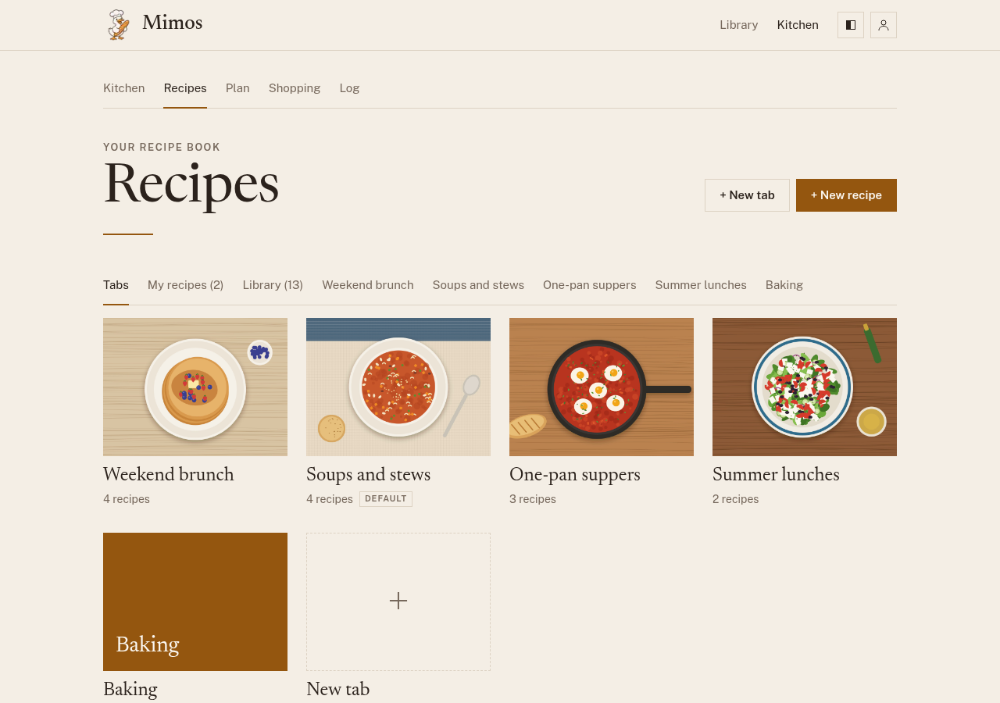

Choose a tile, or the tab's name in the tab bar, to open the tab. Its
recipes are listed like **My recipes**, with the same search, sort, and
tag buttons.

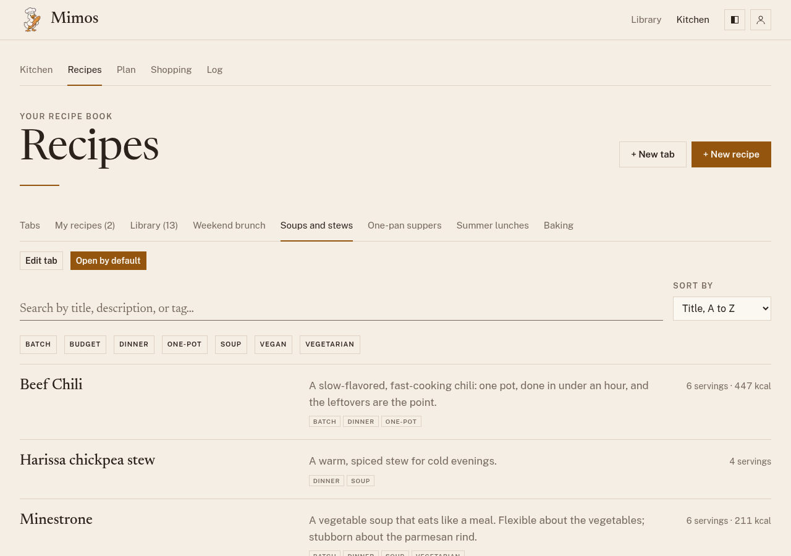

### Opening Recipes on a tab

To skip the gallery, open a tab and choose **Open by default**, or tick
**Open Recipes on this tab** in its form. Recipes then opens straight on
that tab, and the gallery marks its tile **Default**. Choose **Open by
default** again to go back to the gallery.

Your default is your own choice. Someone else in your household can
choose a different tab, or none.

### Editing and deleting a tab

Open the tab and choose **Edit tab**. Change what you like and choose
**Save changes**. To change the cover, choose **Replace picture** or
**Remove picture**. If something can't be saved, the form stays open and
says why. Save again to send the rest.

To delete the tab, choose **Delete tab** in its form. Its recipes stay
where they are. Once a household has no tabs, Recipes opens on **My
recipes** again.

Tabs travel with your recipes in [your export](your-data.md).

### Tabs in the Android app

Tabs work the same way in the app. Tap **+ New tab** beside **+ New
recipe**, give the tab a name, and choose a cover from your photos or take
one with the camera. The tab bar scrolls sideways to show every tab after
**My recipes** and **Library**.

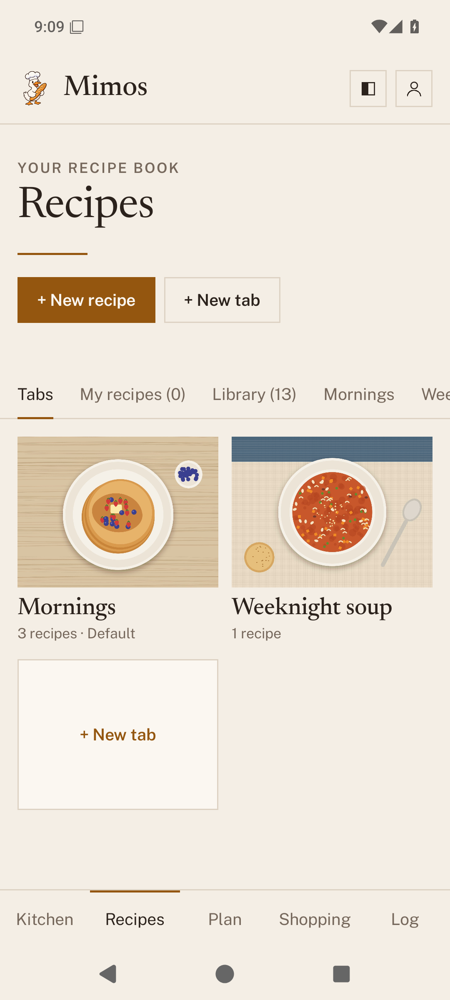

## Cooking from a recipe

Open any recipe to cook from it. The ingredients sit on the left and the
method on the right, with the servings, times, tags, and nutrition per
serving at the top.

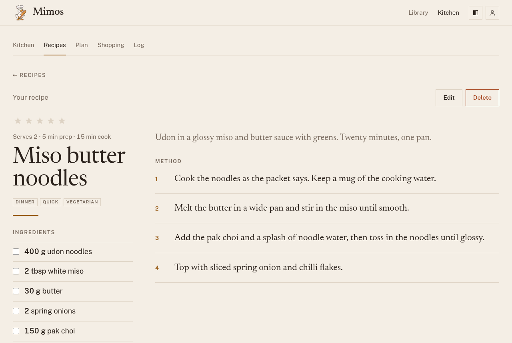

Tap an ingredient to tick it off as you gather it, and tap a step to tick
it off as you go. Ticks are only a cooking aid. They stay while the
browser tab is open, so you can leave a recipe and come back to it, and
they clear when you close the tab.

If one of your recipes has [pictures](#pictures), they show in a row
above the description. Scroll the row sideways to see them all.

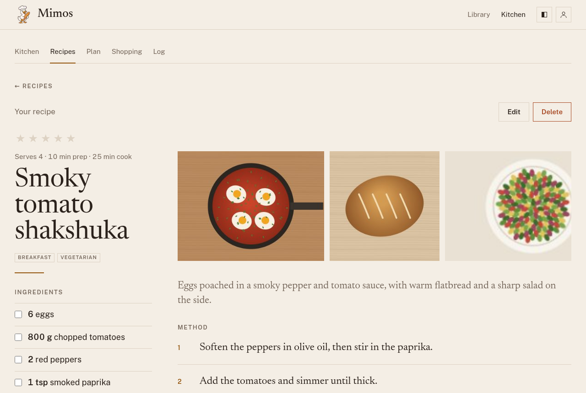

## Writing your own recipe

1. In **Recipes**, choose **+ New recipe**.
2. Give it a title, a short description, and how many servings it makes.
   Prep and cook minutes and tags are optional; separate tags with commas.
3. Add the ingredients, one per line. Type each one's name and pick it
   from the list that appears; put how it's prepared, like "minced", in
   **Note**. Give it an amount and pick a unit from the list. Leave the
   amount blank for things you don't measure, like "salt, to taste", and
   choose **pieces** as the unit for things you count, like "2 eggs".
4. If an ingredient isn't in the list, choose **+ Add "…" as a new
   ingredient** and copy its calories, protein, carbs, and fat from the
   label. It's saved as your household's own: only your household sees
   it, and you can use it in any of your recipes. Under each ingredient, Mimos says what it matched;
   choose **Don't count it** if the match is wrong. Choose **Up** or
   **Down** on a line to move it in the list, and **Remove** to take it
   out.
5. Under **Nutrition per serving**, leave **Calculate from ingredients**
   chosen to have Mimos work it out, or choose **Enter it myself** to type
   it in. Mimos uses it for your [food log](log.md).
6. Add the steps in order, then choose **Create recipe**.

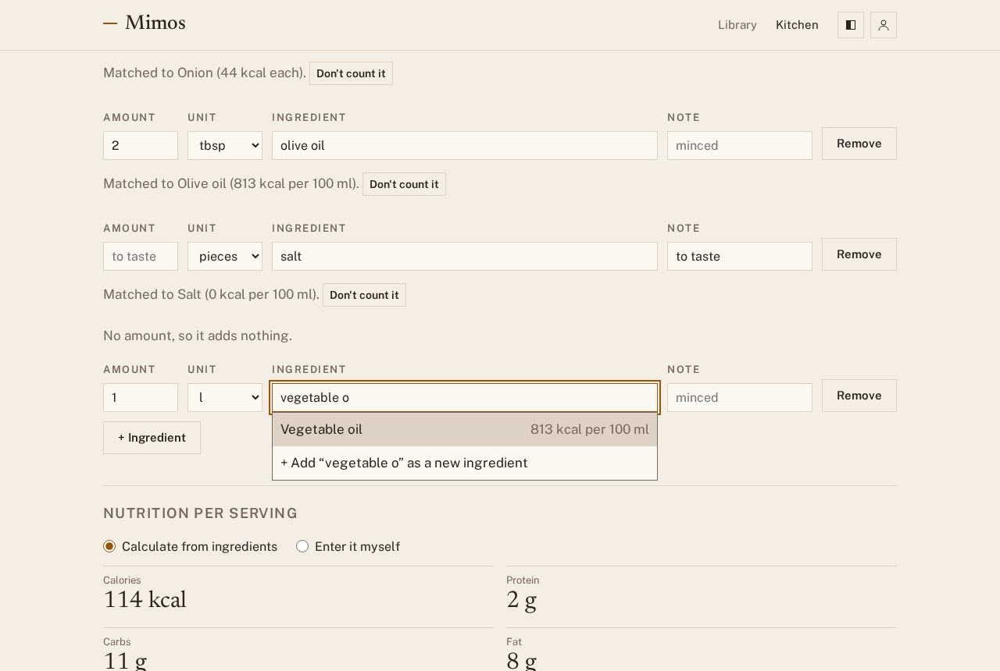

### How nutrition is calculated

Mimos keeps a list of common ingredients with their calories, protein,
carbs, and fat, shared by everyone on this Mimos, alongside the ones you
add yourself. An ingredient adds to the recipe's nutrition when it
matches one of them and is measured in units that ingredient uses:

| The ingredient is measured by | Use these units |
| ----------------------------- | --------------- |
| Weight                        | `g`, `kg`       |
| Volume                        | `ml`, `l`, `tsp` (5 ml), `tbsp` (15 ml) |
| Count                         | `pieces`, like "2 eggs" |

Mimos uses metric units only, so the unit list has no cups or ounces;
write "250 g flour" instead of "2 cups flour". A recipe written before
then keeps its old unit, and that line doesn't count until you change
it. The form says when a line does not count and
which units would, and it shows how many ingredients are counted.
Ingredients without an amount, like salt to taste, add nothing.

Nutrition is calculated each time the recipe is shown, so when the
ingredient list improves, your recipes improve with it. Meals you have
already logged keep the nutrition they were logged with. Library recipes
are calculated the same way.

Your recipes work everywhere library recipes do: you can plan them, they
add to your shopping list, and they count in your food log.

### Using one of your recipes as an ingredient

A recipe can use another of your recipes, like a chicken focaccia
sandwich made with the focaccia you bake from your own recipe. Type the
recipe's name in an ingredient line: your recipes appear in the list
too, marked **Your recipe** with the calories in one serving. Pick one,
then give the amount in **servings** of it, like "2 servings focaccia", or
in **recipe**, the whole of it, which counts every serving the other
recipe makes whatever that is: "1 recipe" of a focaccia that makes 6 servings
is 6 servings. On the recipe page a whole-recipe line reads "1x
Focaccia", with no unit ("2x", "0.5x").

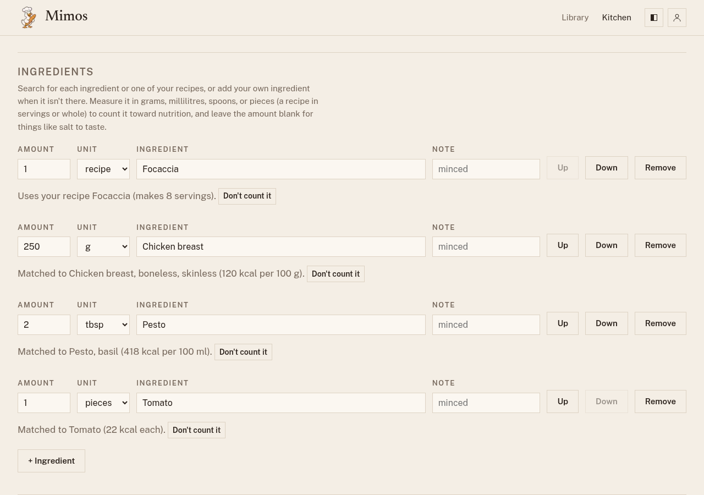

The line counts toward nutrition with the other recipe's nutrition per
serving, as that recipe is now: change the focaccia and the sandwich
follows. A line doesn't count when:

- its unit is anything but servings or recipe, or
- the other recipe's nutrition isn't known yet, because you left some of
  it blank or none of its ingredients count.

On the recipe page, the ingredient links to the recipe it uses. Follow
it and a trail above the recipe shows the way you came, like
"Recipes › Sandwich › Focaccia". Choose a recipe in the trail to go back
to it, with its ticks as you left them. If you
delete that recipe, the line stays in the sandwich but no longer counts.
A recipe can't use itself, or a recipe that already uses it. Your
shopping list shows the line as it is ("2 servings focaccia"), not the
focaccia's own ingredients.

## Pictures

Your recipes can have up to 8 pictures. Library recipes have none.

1. Open the recipe and choose **Edit**, or start a new recipe.
2. Under **Pictures**, choose **Add pictures** and pick one or more JPEG,
   PNG, or WebP pictures. A phone's camera roll works too.
3. Choose **Save changes**, or **Create recipe** for a new one.

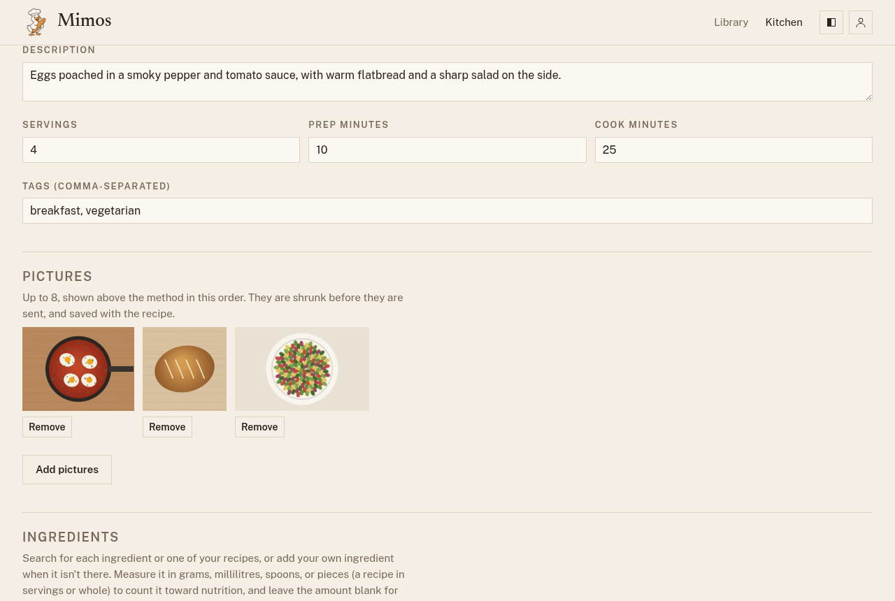

Mimos shrinks each picture before it sends it, to at most 1600 pixels on
its longest side, and saves it as a JPEG. This also removes what the
camera wrote into the file, like where the photo was taken. A new picture
says **Not saved yet** until you save the recipe. A file the browser
can't open, like an iPhone HEIC photo copied to a Windows or Linux
computer, is refused with a message; save it as a JPEG first.

To take a picture out, choose **Remove** under it, then save. Pictures
appear in the order you added them, and nothing changes until you save:
**Cancel** keeps the recipe's pictures as they were. If a picture can't
be saved, the form stays open and says why. Save again to send the
rest.

Everyone in your [household](household.md) sees the pictures, and they
travel with the recipe in [your export](your-data.md).

## Rating a recipe

Open one of your recipes and choose a star, from one to five, to rate it.
Choose another star to change the rating, or the current star again to
take it away. Library recipes can't be rated.

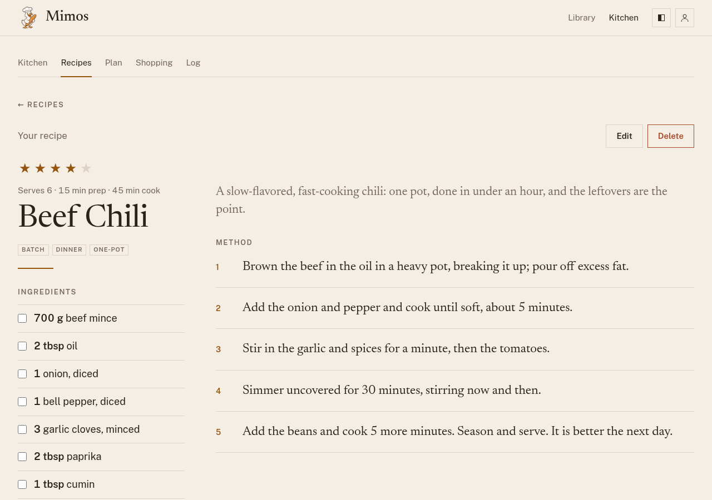

A rating belongs to your [household](household.md): everyone in it sees the
same stars, and whoever rates last sets them. Rated recipes show their stars
in your recipe list. Saving an edit to a recipe keeps its rating, and the
rating travels with the recipe in [your export](your-data.md).

## Editing and deleting

Open one of your recipes and choose **Edit** to change it, or **Delete** to
remove it. Library recipes are read-only.

## Sharing the library

Every library recipe has its own public page, which you can find through
**Library** at the top of any page. Send the link to anyone; they don't
need an account to read it. Your own recipes are never public.

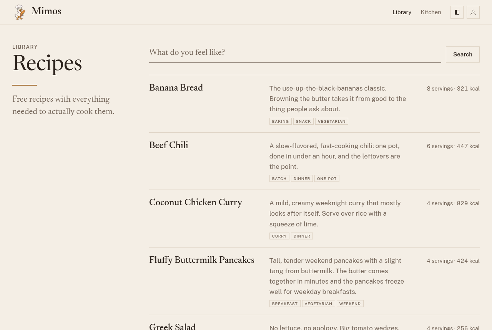
