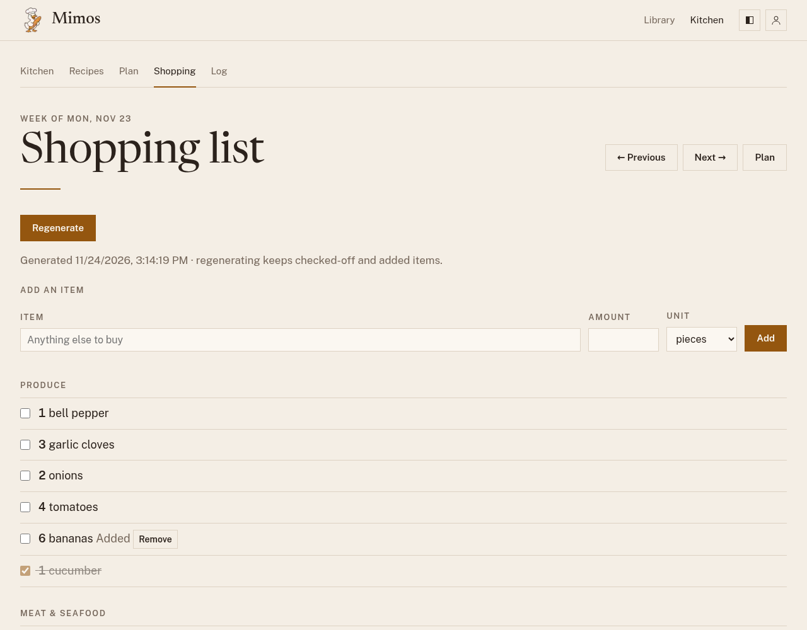

# Shopping list

Open **Shopping** to see the list for a week. Mimos builds it from that
week's [plan](planning.md): every ingredient of every planned meal, scaled
to the servings you planned, with the same ingredient added up across
recipes. Things you buy by the piece, like onions or lemons, are rounded
up to whole ones: half a recipe that needs one onion still puts one onion
on the list. A recipe that uses another of your recipes as an ingredient
puts that recipe's ingredients on the list, not the recipe itself, however
many recipes deep it goes. A [planned food](planning.md#planning-a-single-food) is on
the list too, by its name and amount.

## Making the list

The first time, the page says there's no list for the week yet. Choose
**Generate from this week's plan**. The items are grouped by aisle, such
as produce and pantry, so you can shop the store in one pass.

The list doesn't change on its own when you change the plan. After editing
the week, choose **Regenerate** to bring the list up to date. Anything you
had already ticked off stays ticked off.

## Adding your own items

Not everything you buy is in a recipe. Under **Add an item**, type what
you need, like bin bags or coffee, with an amount if you want one, and
choose **Add**. Pick the amount's unit from the list (`l` for 2 l of milk);
leave it on pieces to count them (2 lemons). It goes in the aisle its
name suggests and is marked **Added**.

Regenerating the list keeps your added items, ticked or not, and never
merges them with the plan's. To take one off the list, choose **Remove**
next to it. Items from the plan can't be removed; change the plan and
regenerate, or tick them off.

If the week has no list yet, adding an item makes one from the week's
plan first.

## In the store

Tick each item off as it goes into the basket. Ticks are saved straight
away, so the list is the same on every device you sign in on. What's still
to buy also shows on the Kitchen page.

Use **← Previous** and **Next →** to see other weeks, and **Plan** to go
back to the week's plan.
